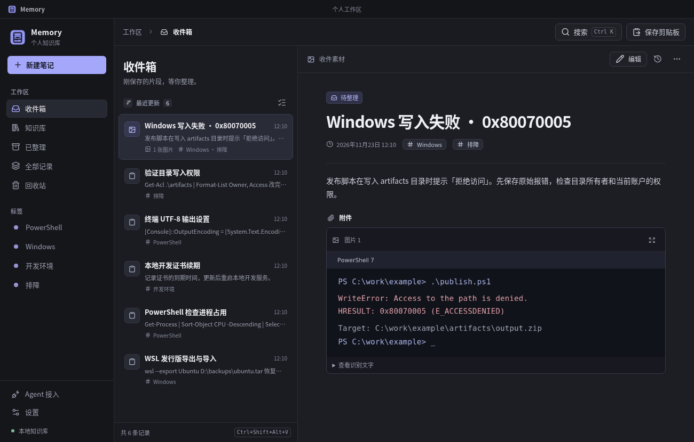

# Memory

Windows 11 x64 本地知识库。平时用快捷键保存剪贴板，之后把收件素材整理成可复用的笔记。Codex、OpenCode 和 Claude Code 可通过本地 MCP 查询、记录和维护同一份知识库。



## 开始使用

1. 安装并打开 Memory。在任意窗口复制一段文字或使用 Windows 截图工具，然后按 **Ctrl+Shift+Alt+V** 保存。设置中可以更换快捷键或启用开机后在托盘启动。
2. 打开收件箱检查刚保存的内容。应用窗口内也可按 **Ctrl+V** 保存。编辑笔记时，粘贴的文本进入正文，PNG/JPEG 图片作为附件。
3. 在收件箱里选择多条素材并点击「整理」。可以手动创建笔记，也可以复制整理指令交给 Agent。排障模板提供现象、原因、解决步骤和验证结果四个段落。
4. 按 **Ctrl+K** 搜索标题、正文、标签或截图中的文字。简体中文和英文 OCR 在本机后台运行，首次识别需要初始化模型。识别失败时可在图片下重试。

打开笔记可查看来源、解除关联、编辑或恢复历史版本。删除后的记录可以在回收站恢复。清空回收站会永久移除其中的记录和相关历史。

## 接入 Agent

打开侧栏「Agent 接入」，选择客户端并复制本机配置。三个客户端使用同一个经 stdio 连接的服务。

| 客户端 | 配置位置 |
| --- | --- |
| Codex | 将生成的 TOML 合并到 `%USERPROFILE%\.codex\config.toml`，用 `codex mcp list` 检查 |
| OpenCode | 将生成的 `mcp.memory` 合并到 `%USERPROFILE%\.config\opencode\opencode.json`，用 `opencode mcp list` 检查 |
| Claude Code | 在 PowerShell 执行生成的命令，用 `claude mcp list` 检查 |

重启客户端后，可以试着说「用 Memory 搜索 `0x80070005`」或「把这次排障过程保存到 Memory」。对现有条目的编辑和删除需要当前版本及知识库标识。客户端按需启动 MCP。关闭应用窗口后，托盘进程继续处理截图识别。退出托盘后，MCP 仍可独立读写，新的截图将在下次启动桌面应用时识别。

普通条目在按需查询时可以进入 Agent 的模型上下文。「仅本机」会在 MCP 层隐藏条目及其来源衍生笔记。该标记不会限制拥有本机文件访问权限的程序直接读取数据文件。

## 数据和备份

默认目录为 `%APPDATA%\Memory\Library`。其中的 SQLite 数据库保存正文、索引、来源关系和历史版本，`images` 保存原图。应用的「设置 → 创建备份」会生成一致副本。「恢复备份」将副本恢复到独立目录并切换过去。可随时切换回原目录，三个 Agent 会跟随活动知识库。

项目仓库只存代码与虚构测试素材。日常记录、数据库、图片和备份保留在自己的知识库目录。

## 开发与构建

在 Windows 11 x64 上安装 Node.js 24 后运行：

```powershell
npm ci
npm test
npm run start
npm run dist:win
```

安装包输出到 `dist/Memory-Setup-0.1.0-x64.exe`。当前构建未签名。使用 `npm run demo` 可在独立数据目录打开虚构示例，示例不随安装包分发。使用 `npm run test:desktop` 运行 Electron 桌面端验收。

桌面端采用 Electron 与原生 Windows 剪贴板、托盘和全局快捷键。数据层使用 SQLite，离线识别使用随应用分发的 Tesseract 模型。开发与打包需要下载依赖，安装后的记录、搜索、备份和 OCR 可离线使用。
